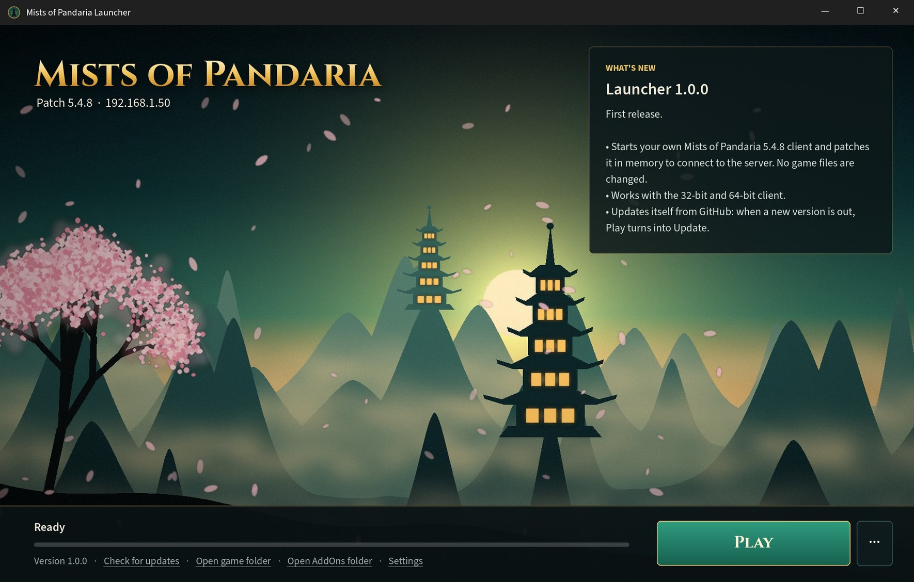

# Mists of Pandaria 5.4.8 Launcher

A Windows launcher for a World of Warcraft: Mists of Pandaria (5.4.8, build 18414) private server.
It starts your own, unmodified game client and patches it **in memory** so it connects to the server.
No game files are changed, and the patches are gone when the game closes.

<p align="center">
  
</p>

**[Download MoPLauncher.exe](https://github.com/Willzman/MoP-5.4.8-Launcher/releases/latest/download/MoPLauncher.exe)**

## Playing

1. Download `MoPLauncher.exe` and put it anywhere you can write to (Desktop, Documents, or the game folder itself).
2. Run it. The first time, choose your 5.4.8 game folder and enter the server address.
3. Press **Play**, then log in from the game as usual.

Windows may show "Windows protected your PC" the first time, because the launcher isn't signed.
Click **More info**, then **Run anyway**.

## Updates

The launcher checks this repository's releases when it starts. When a newer version exists,
**Play** turns into **Update**: it downloads the new `MoPLauncher.exe`, checks its SHA-256,
replaces itself and restarts. Nothing has to be reinstalled.

## Realm news

The **What's new** panel shows the server's latest changes: the newest entries of
[`REALM_NEWS.md`](https://github.com/Willzman/SkyFire_548/blob/Development/REALM_NEWS.md) on the
server repository's `Development` branch, with a link to the whole file. While an update is
waiting, the panel shows what the update brings instead, and when the news can't be read
(offline, say) it shows the launcher's own notes.

To read news from somewhere else (another branch or realm), set `NewsUrl` in
`%AppData%\MoPLauncher\config.json` to the raw address of a file in the same format
(`## YYYY-MM-DD` headings with `- ` lines under them, newest first).

## Music

The launcher plays the Mists of Pandaria login screen music from your own game files
(it reads the archives in the game's `Data` folder; nothing is downloaded or shipped).
The **♪** button next to Play opens a volume slider and the on/off switch. It stops when the game starts.

## Auto-login

Enter your account name and password in **Settings** and tick **Log in automatically when the
game starts**. After Play, the launcher waits for the game's login screen and types the password
into it for you; nothing extra is injected into the game for this.

- The password is stored in `%AppData%\MoPLauncher\config.json`, encrypted with Windows data
  protection for your Windows account. It can't be read by another Windows user or on another PC,
  but programs running as you can decrypt it, as with any saved password. Untick the box to remove it.
- The account name is written to `accountName` in `WTF\Config.wtf`, the same setting the game's
  own "Remember Account Name" box uses.
- A wrong password is tried once; the launcher doesn't retry after the game has contacted the server.

Under Play, the launcher shows **Last played: ACCOUNT - REALM**, read from what the game itself
remembers in `WTF\Config.wtf`.

The launcher remembers every account you save in Settings or log in with from the game, and
every realm the game has been on. Once there is more than one account or realm, that part of the
line becomes a drop-down (the label changes to **Play as:** when it differs from what was last
played). The chosen account is filled in on the login screen and used for auto-login; the chosen
realm is written to `realmName` in `WTF\Config.wtf`, which the game enters after login. To add
an account, type its name and password in Settings and save; **Forget this account** removes one.
Realm names are cleared when the server address changes.

## Server add-ons

The launcher checks that the server's own add-ons and patches are in the game folder and up to
date. When one is missing or older, **Play** turns into **Install add-ons & patches** (as it turns
into **Update** for a new launcher); one click puts them in `Interface\AddOns` and Play is back.
**··· → Play without installing** skips it for that session. Right now the launcher ships:

- **Solo Queue**: a **Solo** checkbox next to **Find Group** in the Dungeon Finder. Tick it and
  click Find Group to queue into the dungeon you picked by yourself: you go in at once, alone. It only shows on realms that
  have solo queue turned on (`DungeonFinder.SoloQueue.Enable` on a SkyFire server).

The launcher keeps a list of every file it installed in `MoPLauncher-installed.txt` in the game
folder. **··· → Remove server add-ons and patches** deletes exactly those files (your own add-ons
are not touched); Play then offers to install them again. MPQ patches the launcher may ship later
work the same way.

## What it patches

The patch set is the classic-login one from the
[Project SkyFire launcher](https://github.com/ProjectSkyfire/launcher):

| Patch | What it does |
| --- | --- |
| Logon hostnames | Overwrites the client's built-in region logon hostnames with the server address |
| DNS hook | Points the client's `gethostbyname` import at a stub that always returns the server |
| Connect redirect | Points the client's `connect` import at a stub that sends every IPv4 connection to the server |
| Login flow | Five small byte patches that make the client use the classic realmlist login |
| Wide screen fix | Only with the "full width of ultrawide screens" setting on: the menus fill screens wider than 16:9, and the character creation screen's class panel and customization column get a right border, and its portraits are zoomed back out to their 16:9 framing (skipped if it can't be applied). With the setting off, the menus are not patched |

It also sets `realmlist` in `WTF\Config.wtf`. SkyFire's experimental Battle.net ("authnet")
login is not included.

Because of the connect redirect, the login and world server are expected to be on the same
address. If yours are on different machines, turn off **Send all game connections to this
server** in Settings.

## For the server owner

- **Ship it pointed at your server:** set `ServerAddress` (and optionally `RealmName`) in
  [`src/MoPLauncher/Config/ServerDefaults.cs`](src/MoPLauncher/Config/ServerDefaults.cs).
  New installs then only have to choose their game folder.
- **Ship an add-on or patch:** put its files under
  [`src/MoPLauncher/ClientFiles`](src/MoPLauncher/ClientFiles) at the path they need in the game
  folder (for example `ClientFiles\Interface\AddOns\MyAddon\MyAddon.toc`, or a patch under
  `ClientFiles\Data\…`). They are embedded in the exe; players whose game folder lacks them (or has
  older ones) see **Install add-ons & patches** on the Play button, and **Remove server add-ons and
  patches** takes them out. A file dropped from `ClientFiles` is removed on the player's next install.
- **Release an update:** bump `<Version>` in
  [`src/MoPLauncher/MoPLauncher.csproj`](src/MoPLauncher/MoPLauncher.csproj), add a section for it
  to [`CHANGELOG.md`](CHANGELOG.md), and push to `main`. The workflow builds the launcher and
  publishes the release; every installed launcher offers it on its next start.

## Building

Needs the .NET 10 SDK on Windows. For the login music, also CMake and Visual Studio's C++ tools,
and run `tools/build-stormlib.ps1` once first (the launcher builds without it, minus the music).

```
dotnet publish src/MoPLauncher/MoPLauncher.csproj -c Release -o publish
```

The artwork is generated by `python tools/make_art.py` (Pillow and numpy).

## Licence

GPL-3.0, the same as the Project SkyFire launcher the patches come from.
See [LICENSE](LICENSE) and [THIRD-PARTY-NOTICES.md](THIRD-PARTY-NOTICES.md).
